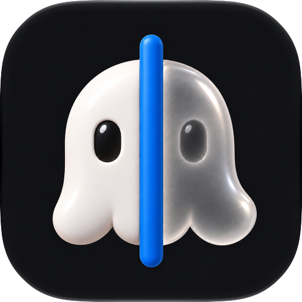
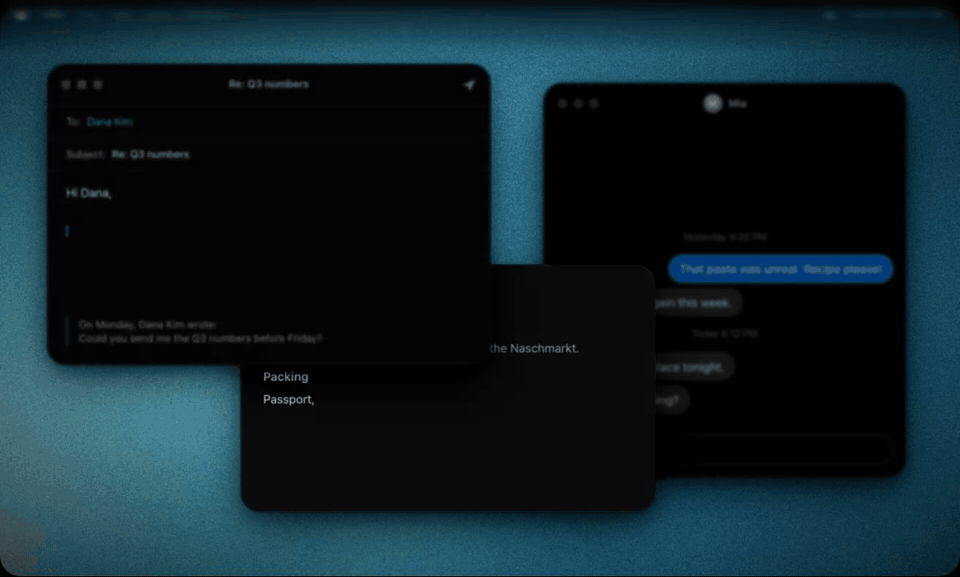

<div align="center">
  
  <h1>Ghostwriter</h1>
  <p><strong>Autocomplete for your whole Mac.</strong></p>
  <p>
    <a href="https://github.com/mshll/ghostwriter/releases/latest"></a>
    
    
    <a href="LICENSE"></a>
    <a href="https://github.com/mshll/ghostwriter/actions/workflows/ci.yml"></a>
  </p>
</div>

<p align="center"></p>

Ghostwriter shows a suggestion in grey at your cursor while you type, in any app. A language model on your Mac writes it, so your writing stays on your Mac.

Press Tab. That's the interface. Tab takes the next word, and the key above Tab takes all of it.

## Features

- **Suggestions everywhere.** Mail, Messages, Notes, Slack, browsers, code editors: any text field that macOS can read. Also in the middle of a line.
- **Fluent in yours, right to left too.** The default model writes English, Arabic, French, German, Spanish, Japanese, Chinese and more.
- **It sounds like you, app by app.** Ghostwriter stores what you write on this Mac and uses it to match your words and tone. You can add instructions about yourself, and different instructions for each app.
- **Reads the context.** It can use the text near your cursor, such as the message you reply to, and text you copied recently.
- **Longer drafts.** The next sentence or paragraph, on demand.
- **Actions for selected text.** Rephrase, fix grammar, shorten, change the tone, translate or find synonyms, with Apple Intelligence on this Mac.
- **Proofread with one shortcut.** Fixes spelling, grammar and punctuation in the selection, or in the paragraph before the cursor, and keeps your wording. Press the shortcut again to undo.
- **Snippets.** Short triggers for long text: type `;addr` to insert your address. Placeholders: `{date}`, `{time}`, `{clipboard}`, `{cursor}` and `{ai: instruction}`.
- **Your rules for each app.** Turn suggestions off, stop recording, change the insertion method or add instructions for one app.
- **Typo fixes.** A misspelled word is struck through with the fix next to it: Tab applies it, Esc keeps your word. Names and words you write often are left alone. Optionally, obvious typos are fixed as you type, and Delete right after undoes the fix.
- **Emoji.** Type `:smile` to pick an emoji.

## Privacy

Your words never leave this Mac.

- Ghostwriter has no cloud service, no account, no analytics and no telemetry.
- It connects to the internet for two things only: model downloads from Hugging Face and update checks.
- It never records text from secure fields, password managers or apps you exclude.
- Recorded writing, snippets and statistics are in one database file on your Mac. Settings > Privacy & Data shows it, and you can erase it there.
- Screenshots for text recognition (optional) stay in memory and are discarded at once.

## Install

Requires macOS 26 or later on a Mac with Apple silicon.

**Homebrew**

```sh
brew install --cask mshll/tap/ghostwriter
```

**Manual**

Download the latest `Ghostwriter-<version>.dmg` from [Releases](https://github.com/mshll/ghostwriter/releases/latest), open it and drag Ghostwriter to Applications.

Ghostwriter updates itself. Settings > Updates controls the checks.

### First launch

A full-screen setup walks you through these steps:

1. **Accessibility** (required): lets Ghostwriter read the field you type in and type the words you take.
2. **A model.** Ghostwriter recommends one for your Mac's memory and chip, then downloads it in the background and checks its checksum.
3. **Make it yours** (optional): your name, a few lines about how you write, learning from your writing, and fixing obvious typos as you type.
4. **Context** (optional): text from the window you type in, screenshots for apps that hide their text (Screen Recording), and text you copied (Paste from Other Apps).
5. **Try it** in a practice field, then choose whether Ghostwriter opens at login.

Press Esc to skip the setup. Settings > General > Replay Onboarding shows it again.

Turn off macOS's own inline predictions so they do not compete: System Settings > Keyboard > Text Input > Edit > "Show inline predictive text".

## Usage

| Key | Action |
|---|---|
| <kbd>Tab</kbd> | Accept the next word |
| Key above Tab (<kbd>`</kbd> on a US keyboard) | Accept the whole suggestion |
| <kbd>⌥</kbd> <kbd>Tab</kbd> | Type a real Tab while a suggestion shows |
| <kbd>Esc</kbd> | Hide the suggestion and pause briefly (Settings > Suggestions can change this) |
| <kbd>⌥</kbd> <kbd>`</kbd> | Write a longer draft |
| <kbd>⌃</kbd> <kbd>`</kbd> | Suggest now |
| <kbd>⌥</kbd> <kbd>⇧</kbd> <kbd>`</kbd> | Actions for selected text |
| <kbd>⌥</kbd> <kbd>⌘</kbd> <kbd>`</kbd> | Proofread the selection or the current paragraph (press again to undo) |
| <kbd>⌃</kbd> <kbd>⌥</kbd> <kbd>`</kbd> | Turn suggestions off or on |
| <kbd>⌃</kbd> <kbd>⌥</kbd> <kbd>⌘</kbd> <kbd>`</kbd> | Pause in the current app for 15 minutes |

Tab and the key above Tab act only while a suggestion shows. At other times they type as usual. You can change every key in Settings > Shortcuts.

## Models

Ghostwriter runs a base (pretrained) model through [llama.cpp](https://github.com/ggml-org/llama.cpp).

| Model | Download | Best for |
|---|---|---|
| Gemma 4 E2B | 3.6 GB | Most Macs (16 GB of memory). The default. |
| Gemma 4 E4B | 5.8 GB | The most accurate. Fast Macs with 24 GB or more. |
| Gemma 3 4B | 2.5 GB | Smaller download, a little slower. |
| Gemma 3 1B | 0.8 GB | Macs with 8 GB of memory. |

To use your own model, put a base `.gguf` file in `~/Library/Application Support/com.mshl.ghostwriter/Models/` and click Refresh in Settings > Model. Each model has its own license; Gemma models are provided under the [Gemma Terms of Use](https://ai.google.dev/gemma/terms).

[docs/MODELS.md](docs/MODELS.md) explains why base models, and how these were selected and measured.

## FAQ

<details>
<summary><strong>Suggestions do not appear in an app.</strong></summary>

Some apps, often web or Electron apps, do not give their text to Accessibility. Open Settings > Apps, add the app and turn on "Improve compatibility". If the app still hides its text, allow Screen Recording so Ghostwriter can read text from a screenshot of the window. In a field where suggestions do not start automatically, press Suggest now (<kbd>⌃</kbd> <kbd>`</kbd>).
</details>

<details>
<summary><strong>Accepted text arrives garbled.</strong></summary>

Some apps handle typed text in an unusual way. In Settings > Apps, set "Insert text by" to pasting for that app.
</details>

<details>
<summary><strong>Does it use Apple Intelligence?</strong></summary>

Only for the actions on selected text, the proofread shortcut and the `{ai: …}` snippet placeholder. Autocomplete and typo fixes use Ghostwriter's own model, because it is faster and more accurate for these tasks. If Apple Intelligence is off or unavailable, those actions are hidden and the proofread shortcut is turned off.
</details>

<details>
<summary><strong>How much battery does it use?</strong></summary>

On battery, in Low Power Mode or when the Mac is hot, Ghostwriter does less work while you type through a suggestion. Settings > Model can also give shorter suggestions or switch to a smaller model on battery.
</details>

<details>
<summary><strong>Why only Apple silicon and macOS 26?</strong></summary>

The model runs on the GPU through Metal and needs Apple silicon to be fast enough. macOS 26 provides the Foundation Models framework and the system APIs that the app uses.
</details>

## Uninstall

Quit Ghostwriter from the menu bar and move it to the Trash. To remove its data too (models, recorded writing, snippets and statistics):

```sh
rm -rf ~/Library/Application\ Support/com.mshl.ghostwriter
defaults delete com.mshl.ghostwriter
```

With Homebrew: `brew uninstall --zap --cask ghostwriter`.

## Build from source

You need Xcode 27 and [XcodeGen](https://github.com/yonaskolb/XcodeGen) (`brew install xcodegen`).

```sh
git clone https://github.com/mshll/ghostwriter.git
cd ghostwriter
xcodegen generate
xcodebuild -project Ghostwriter.xcodeproj -scheme Ghostwriter -configuration Debug \
  CODE_SIGN_IDENTITY=- DEVELOPMENT_TEAM= build
```

[CONTRIBUTING.md](CONTRIBUTING.md) explains signing, the project layout, tests and the evaluation tools.

## Contributing

Bug reports, ideas and pull requests are welcome. Read [CONTRIBUTING.md](CONTRIBUTING.md) before you open a pull request. Report security issues privately, as [SECURITY.md](SECURITY.md) describes.

## Acknowledgments

- [llama.cpp](https://github.com/ggml-org/llama.cpp) runs the models.
- [GRDB](https://github.com/groue/GRDB.swift) stores your writing, snippets and statistics.
- [KeyboardShortcuts](https://github.com/sindresorhus/KeyboardShortcuts) records the global shortcuts.
- [Sparkle](https://sparkle-project.org) installs updates.
- Model files come from [Google's Gemma](https://ai.google.dev/gemma) family, quantized by [mradermacher](https://huggingface.co/mradermacher).

## License

Ghostwriter is free software under the [GNU General Public License v3.0](LICENSE).
