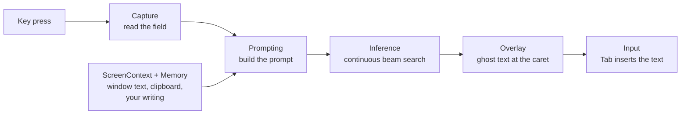

# How a suggestion is made

This document follows a suggestion from a key press to the ghost text on screen. Numbers are from an M1 Pro with 16 GB of memory and Gemma 4 E2B.

The goal: while you type at a steady speed, a suggestion that matches what you typed is on screen within about 100 ms of each key press.

## Pipeline

`CompletionCoordinator` (in the app target) connects the modules. Each module is a target in `Packages/GhostwriterKit`.

### 1. Capture

`FocusTracker` follows the focused text field through Accessibility. `FieldReader` reads the text before and after the caret, the caret's position and the field's font. `FieldClassifier` decides what kind of field it is (email, chat, document, search, code, form and others) from its role, its labels and the app. Secure fields, fields that look like they hold a password, and password managers are never read.

Some apps report their text in unusual ways. `BuiltInAppRules` holds adjustments for known apps. Users can add their own in Settings > Apps.

### 2. Context

Besides the text in the field, the prompt can contain:

- **Your writing.** `Memory` stores the text of fields where Ghostwriter suggests, in a SQLite database on the Mac. For each request it finds passages of earlier writing that share distinctive words with what you type, with full-text search, and prefers the same app and recent text. These passages are examples of your style.
- **Window text.** `ScreenContext` reads the visible text near the caret through Accessibility, nearest paragraph first: for example, the message you reply to. When an app hides its text, it can recognize the text in a screenshot of the window (with Screen Recording permission).
- **Clipboard.** Text you copied in the last few minutes. Concealed items, such as passwords, are skipped.
- **Instructions.** What you wrote about yourself in Settings > Personalization, and instructions for the current app.

### 3. Prompt

Autocomplete runs a base model, which continues text. The prompt is therefore a plain document, not a chat: a short preamble, then labeled sections, then the text you typed. The model continues from the end.

The order of the sections matters for speed:

1. Preamble, instructions, environment (app, window title, field kind)
2. Examples of your writing, clipboard, window text
3. Text after the caret (when typing in the middle of a line)
4. Lines that change more often, such as the date and the detected language
5. The text before the caret

llama.cpp keeps the decoded prompt in its KV cache. When you type, only the end of the prompt changes, so only the new characters are decoded. A change near the start of the prompt makes the engine decode everything after it again: about 1 s for a screen of window text.

Each section has a token budget (`PromptBudgets`). The text before and after the caret get their share first, so the context sections keep the same size while you type and the cache stays valid.

### 4. Engine

`CompletionEngine` runs llama.cpp on the GPU. One context of 4,096 tokens holds the prompt and every candidate.

**Beam search.** The engine searches for the most probable continuations with a beam search. At the end of a line it keeps 6 beams up to the word limit of the chosen suggestion length. A length penalty and a probability floor control which candidates it keeps.

**Units.** The engine works in small units: one chunk of prompt (128 tokens) or one beam step (one batched decode for all live beams). Requests go into a mailbox that holds only the newest one. Between units, the engine takes the newest request. A key press therefore reaches the engine within one unit, about 20 to 40 ms, and no decode is stopped half done.

**Following your typing.** When the new text is the old text plus the characters you typed, the engine does not start again. It drops the beams that do not start with the typed characters and continues the others. Suggestions that still fit show at once, with no decode. Any other change (a deletion, a caret move, another field) starts a new search; the cached prompt is kept up to the first change.

**Parked beams.** A beam that reaches the word limit is parked with its cache entry. When you accept or type a word of it, the beam continues from where it stopped.

**Growing phrases.** Each step publishes its finished candidates and its live beams cut to the last whole word. A phrase shows as soon as its first word is known and grows while the search continues. While you type, a shown suggestion is replaced only by one that extends it, so the text does not change under your eyes. When you pause, a finished search can replace the shown suggestion with its best candidate 300 ms after the key press.

**Mid-line.** In the middle of a line, a candidate must fit the text after the caret. Each candidate is scored together with the first tokens after the caret, and must score better than inserting nothing. These scores are decoded in the same batch as the next beam step, so they cost little extra time.

**Drafts.** A long draft streams the text that all live beams have in common, cut to whole words. Streamed words never change.

**New context.** When window text or new examples arrive, the engine decodes the new prompt in a separate cache sequence while it continues to answer key presses with the old one. It switches to the new prompt when it is ready. While you type it decodes 32 tokens per unit, so a key press waits at most for one small unit.

**Power.** On battery, in Low Power Mode, or when the Mac is hot, the engine works in economy mode: it does not follow your typing while a suggestion shows.

### 5. Display and accept

`Overlay` draws the suggestion in a transparent panel at the caret, in the field's font, with right-to-left support. In the middle of a line it samples the field's background so the ghost text covers the text after the caret cleanly.

`Input` watches the accept keys. Tab and the key above Tab act only while a suggestion shows. `TextInserter` types the accepted text with key events, or pastes it in apps that need that. Every event that Ghostwriter posts carries the `EventMarker` tag, and Ghostwriter ignores events with that tag, so it never reacts to its own typing.

### Typo fixes

When a space or punctuation finishes a word, `Proofing` asks the system spell checker whether the word is misspelled and for its guesses. The engine then scores the typed word and each guess as the continuation of the same prompt. A fix is offered when a guess is clearly more likely than the typed word, so names, jargon and words from another language that the model expects stay unflagged. Words that appear in several of your recorded writing sessions are never flagged. At the end of a sentence the same check runs on every word of the sentence. `gw-eval --typos` measures the thresholds ([EVALUATION.md](EVALUATION.md)).

Automatic fixes need a larger margin, and the best guess must lead the next one, so a word with two plausible fixes is offered, not fixed. They run only in English, French, German and Spanish, where `gw-eval --typos` measured them right about 98% of the time.

## Results

Measured with `gw-eval` on 352 rows of recent web text in 7 languages, typed at 6 characters per second ([EVALUATION.md](EVALUATION.md)):

| | Keystrokes saved | Matching suggestion within 100 ms | Wait p50 / p95 |
|---|---|---|---|
| One search at a time | 33.8% | 58.2% | 218 / 1,233 ms |
| Continuous search | **39.5%** | **93.1%** | **74 / 333 ms** |

Economy mode saves as many keystrokes with 11% to 16% less compute time. Decoding new window text in a separate sequence cut the extra wait per key press from 268 to 21 ms.
